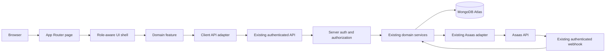

# Arquitetura Proposta para o Novo Frontend

**Status:** arquitetura alvo para aprovação, sem implementação.  
**Princípio:** mudar apresentação e composição; preservar MongoDB, APIs, autenticação, autorização, Asaas e contratos de dados.

## 1. Objetivos e limites

- Remover a concentração de shell, módulos e fluxos em `app/page.jsx` sem reconstruir o backend.
- Dar navegação e espaço de trabalho próprios a ADMIN, PROFESSOR e ALUNO, sempre determinados por identidade/role verificados no servidor.
- Manter URLs externas atuais (`/`, `/login`, `/register`, `/forgot-password`, `/billing`, `/privacy`) compatíveis; rotas internas novas devem ter fallback/redirect explícito, não quebrar bookmarks.
- Continuar consumindo as APIs existentes em `/api/**`; nenhuma API nova é requisito do redesign.
- Componentes recebem dados tipados/normalizados de adaptadores da UI. Não ler MongoDB nem importar módulos server-side em componente client.
- A UI nunca decide autorização, tenant, valor, estado de pagamento ou titularidade; servidor continua autoridade.

## 2. Árvore proposta

A organização é sugestão, não migração a executar sem aprovação. Route groups do Next não alteram a URL pública.

```text
app/
  layout.jsx                       # metadata, idioma e estilos base
  globals.css                     # reset e import dos tokens
  (public)/
    login/page.jsx
    register/page.jsx
    forgot-password/page.jsx
    privacy/page.jsx
  (workspace)/
    layout.jsx                     # valida sessão e compõe AppShell
    page.jsx                       # compatibilidade `/` e roteamento por role
    admin/
      page.jsx                     # dashboard do admin
      students/page.jsx
      team/page.jsx
      exercises/page.jsx
      workout-plans/page.jsx
      history/page.jsx             # se a rota/consulta atual for confirmada
    professor/
      page.jsx
      students/page.jsx
      students/[id]/page.jsx
      workout-plans/page.jsx
    aluno/
      page.jsx
      treino/page.jsx
      historico/page.jsx
      perfil/page.jsx
  billing/page.jsx                 # preservar endpoint/URL e controle de acesso
  api/                             # intocado nesta fase

components/
  ui/                              # Button, Input, Select, Dialog, Table, estados
  shell/                           # AppShell, Sidebar, Topbar, mobile nav
  feedback/                        # Toast, Alert, Skeleton, ErrorState
  media/                           # ExerciseMedia e renderer preservado

features/
  auth/                            # telas/forms; cliente do endpoint existente
  dashboard/                       # visões por papel
  students/                        # lista, formulário, perfil e vínculos
  team/                            # gestão de professor/equipe
  exercises/                       # biblioteca, editor, importação wger e mídia
  workout-plans/                   # lista, editor, detalhe, picker, ordenação
  workout-execution/               # UI de registro atual; sem nova entidade implícita
  history/                         # sessões e medidas, contratos atuais
  billing/                         # experiência do pagador + status existentes
  finance-admin/                   # 12 seções do proprietário
  profile/                         # medidas/perfil
lib/client/
  api-client.js                    # JSON, erros e same-origin; sem segredo
  route-guards/                    # apenas UX; não substitui guards servidor
styles/
  tokens.css
  typography.css
  primitives.css
  layouts.css
  motion.css
```

As páginas de admin/professor/aluno representam a **navegação UI** e não adicionam papéis novos nem rotas API novas. Se separar layouts por grupo implicar mudança de autorização, permanecer no mesmo caminho até que seja aprovado e testado.

## 3. Camadas e responsabilidades

### App Router e shell

- Layout público define `lang`, metadata e estilos básicos.
- Layout do workspace consulta sessão no servidor com mecanismo existente (`getCurrentUser`/cookies) e renderiza a área autorizada.
- `/` continua compatível e leva ao dashboard adequado ao papel. A UI não usa um dropdown de role para conceder acesso.
- Shell recebe navegação preparada por papel, localização e permissões visuais; endpoint continua checando todas as operações.
- `billing` permanece acessível por conta autenticada bloqueada, conforme `allowBlocked` atual.

### Features de domínio

Cada feature contém `components/`, `api.js` (somente fetch client para rotas existentes), `schemas.js` (validação visual, não substitui server validation), e arquivos de apresentação. Evitar abstração genérica com dezenas de props. Dados financeiros mantêm centavos, BRL e estados sem converter para modelos inventados.

### Componentes de UI

Componente base é neutro ao domínio e oferece estados acessíveis. Componentes de domínio como `InvoiceStatus`, `ExerciseMedia` e `WorkoutExerciseRow` traduzem atributos conhecidos sem mutar ou descartar campos persistidos. Não criar design system duplicado dentro de `page.jsx`.

### Dados e estados

- Loading/empty/error/forbidden/expired-session são explicitamente modelados.
- Respostas de erro do backend não são substituídas por array vazio nem amostra de demonstração.
- Toast de sucesso ocorre após resposta 2xx e, em fluxos de persistência, após confirmação da API.
- Filtros e paginação respeitam comportamento atual; não baixar tudo para filtrar client-side.
- Formulários preservam valores após erro recuperável; navegação com formulário sujo deve pedir confirmação conforme fluxo aprovado.

## 4. Contratos que continuam estáveis

- Sessão `atlas_session`, login username/senha e logout por rota atual.
- Roles: `student`, `trainer`, `admin`, `dev`, `SUPER_ADMIN`; proprietário especial segue a regra existente.
- API users, exercises, workout-plans, workouts, workout-exercises, workout-history, body-measurements, dashboard e finance permanecem intactas.
- Ficha continua ligada por `studentId`, `trainerId`, dias `workouts`, exercícios por `exerciseId`; edição preserva histórico e arquivamento.
- Mídia usa campos/IDs e URLs já existentes, quando disponíveis. Componentes não inventam URLs, licenças ou mídia offline.
- Asaas continua atrás do service/adapter; browser chama `/api/finance/**` e não conhece API key, customer de outra conta ou valor autoritativo.
- Conteúdo do dashboard é dado real; sem novos KPIs até existirem consulta e definição aprovadas.

## 5. Componentes a criar/substituir

### Criar

- `AppShell`, `DesktopSidebar`, `MobileNav`, `Topbar`, `Breadcrumbs`, `UserMenu`, `PageHeader`.
- Kit: `Button`, `IconButton`, `Input`, `PasswordInput`, `Select`, `SearchInput`, `Checkbox`, `Switch`, `Badge`, `Avatar`, `Tabs`, `Table`, `Pagination`, `Dialog`, `Drawer`, `Tooltip`, `Toast`, `Alert`, `Skeleton`, `EmptyState`, `ErrorState`, `ConfirmDialog`.
- Dashboard: `AdminDashboard`, `TrainerDashboard`, `StudentHome`; componentes de indicador acionáveis somente quando houver rota/dados.
- Admin: `StudentDirectory`, `StudentForm`, `StaffDirectory`, `ExerciseLibrary`, `ExerciseEditor`, `WorkoutPlanDirectory`.
- Professor: `AssignedStudentList`, `StudentWorkspace`, `WorkoutPlanEditor`, `ExercisePicker`.
- Aluno: `WorkoutExecution`, `ExerciseStep`, `SetEntry`, `WorkoutHistory`, `MeasurementHistory`; `RestTimer` somente como controle visual local sem afirmar persistência/estado de sessão novo.
- Billing UI: `BillingAccount`, `InvoiceRow`, `CheckoutActions`, `PaymentStatus`; finance owner: `FinanceSectionTabs`, `PlanTable`, `SubscriptionTable`, `InvoiceTable`, `PaymentTable`, `PayoutTable`, `LedgerTable`.
- Media: componente wrapper que integra versão correta de `ExerciseAnimation` e deixa a fonte/atribuição explícita.

### Substituir/reduzir

- Substituir `app/page.jsx` por composição de rota/shell e views importadas, removendo lógica duplicada da página raiz gradualmente.
- Substituir CSS de overrides (`globals.css`, `workout-plans.css`, `student-overrides.css`, `profile-overrides.css`, `body-map-overrides.css`, `auth-overrides.css`, `finance.css`, `billing.css`) por tokens e estilos de componentes por feature, em commits incrementais.
- Reescrever markup de `components/WorkoutPlanManager.jsx` e `components/FinancialManager.jsx` em componentes menores mantendo os serviços/rotas atuais.
- Reorganizar markup de login, registro, esqueci senha, billing e privacidade sem mudar endpoint, conteúdo ou regra de acesso.
- `ExerciseAnimation.jsx` só pode ser substituído depois de recuperar a versão do SHA aprovado e fazer inventário de URLs/atribuições.

### Não alterar neste trabalho

`lib/models.js`, `lib/mongodb.js`, `lib/session.js`, `lib/auth.js`, `lib/api-auth.js`, `lib/roles.js`, `lib/finance-service.js`, `lib/payment-provider.js`, `lib/payment-providers/**`, `lib/finance-jobs.js`, `lib/finance-payouts.js`, `app/api/**`, variáveis e configurações de produção. Se qualquer limitação exigir mudança, abrir proposta backend separada.

## 6. Estratégia de dependências

Começar com React/Next/CSS existentes. Antes de escolher biblioteca de ícones, tabela, drag-and-drop ou gráfico, verificar pacote instalado, tamanho do bundle, keyboard support, licença e compatibilidade React/Next. Não usar pacote de animação para transições curtas que CSS resolve. Não adicionar font dependency sem estratégia de CSP/self-host e medição de performance.

## 7. Diagrama de fluxo



O browser não acessa MongoDB nem Asaas com segredo. O diagrama explicita que a mudança alvo está até `Client API adapter`; serviços e persistência não são parte da reimplementação visual.

## 8. Critérios arquiteturais de aceite

- Toda tela privada renderiza por identidade/role confiáveis; guards backend seguem ativos.
- Nenhuma importação de lib server-side em client components.
- Componentes de UI não fazem persistência direta ou contêm valor financeiro autoritativo.
- APIs atuais e payloads são cobertos por testes de contrato/regressão antes de remover markup antigo.
- Uma rota quebrada, sem API ou sem permissão não aparece como botão ativo.
- Acessibilidade, estados e responsividade são responsabilidades definidas por componente, não CSS ad hoc no monólito.
